# Guia Completo de Orquestração de Subagentes

Este documento detalha o funcionamento, ciclo de vida e gerenciamento de **Subagentes** dentro do ecossistema **Antigravity**, além de especificar as regras de delegação automática de tarefas aplicadas ao projeto.

---

## 1. O que são Subagentes?

No Antigravity, os subagentes são instâncias especializadas executadas concorrentemente em segundo plano (*background*). Eles possuem sua própria identidade, prompts de sistema específicos e permissões customizadas de ferramentas.

Eles são ideais para:
*   Dividir tarefas complexas em subtarefas paralelas.
*   Executar rotinas de compilação, testes ou lints sem travar o agente principal.
*   Fazer pesquisas profundas de base de código em sandbox isolado.

---

## 2. Ciclo de Vida do Subagente na Plataforma

A plataforma fornece quatro primitivas fundamentais sob a forma de ferramentas para gerenciar subagentes.

### 2.1 Definir (`define_subagent`)
Antes de utilizar um subagente customizado, você deve registrá-lo na sessão.

*   **Identificador:** `define_subagent`
*   **Parâmetros principais:**
    *   `name`: Nome exclusivo da classe de subagente (ex: `lint-fixer`).
    *   `description`: Quando e por que este subagente deve ser usado.
    *   `system_prompt`: O prompt de sistema definindo regras estritas e a persona do worker.
    *   `enable_write_tools`: Concede permissão de escrita de arquivos e execução de comandos.
    *   `enable_mcp_tools`: Habilita acesso a servidores MCP.
    *   `enable_subagent_tools`: Permite que o subagente crie e invoque seus próprios subagentes.

### 2.2 Invocar (`invoke_subagent`)
Inicia a execução de uma tarefa por um subagente cadastrado ou nativo (como `research` e `self`).

*   **Identificador:** `invoke_subagent`
*   **Modos de Workspace (`Workspace`):**
    *   `inherit` *(padrão)*: Executa no mesmo diretório compartilhado do agente principal.
    *   `branch`: Cria uma cópia isolada do repositório físico em sandbox para trabalhar sem sujar a árvore principal.
    *   `share`: Compartilha a pasta física mas opera em ramificação (branch) Git separada.
*   **Parâmetros principais:**
    *   `TypeName`: O tipo do subagente (ex: `research`).
    *   `Role`: Título de função curto (ex: `Codebase Researcher`).
    *   `Prompt`: A instrução de tarefa específica que o subagente deve cumprir.

### 2.3 Comunicar (`send_message`)
Permite a troca de mensagens bidirecionais assíncronas com o subagente.

*   **Identificador:** `send_message`
*   **Parâmetros:**
    *   `Recipient`: O `conversationID` único da tarefa (retornado pelo `invoke_subagent`).
    *   `Message`: O payload textual com novos dados ou diretrizes.

> [!NOTE]
> Você **não precisa** fazer polling ou consultas repetidas sobre o status do subagente. O sistema utiliza **Reactive Wakeup**, acordando você de forma assíncrona assim que o subagente enviar uma nova mensagem ou concluir o trabalho.

### 2.4 Gerenciar (`manage_subagents`)
Permite auditoria e interrupção de tarefas em segundo plano.

*   **Identificador:** `manage_subagents`
*   **Ações suportadas:**
    *   `list`: Retorna todos os subagentes ativos e seus respectivos `conversationID`s.
    *   `kill`: Finaliza um subagente específico e limpa seus workspaces temporários.
    *   `kill_all`: Aborta todos os subagentes associados à árvore do agente atual.

---

## 3. Fluxo de Execução Assíncrona

```mermaid
sequenceDiagram
    autonumber
    participant A as Agente Principal
    participant S as Subagente (Worker)
    
    A->>S: invoke_subagent (Prompt da Tarefa + Workspace: branch)
    Note over S: Cria sandbox físico isolado
    rect rgb(20, 20, 30)
        S->>S: Executa tarefa, lint, testes ou geração de código
    end
    S-->>A: Envia relatório com resultados (Reactive Wakeup)
    A->>A: Avalia resultados e incorpora na base principal
```

---

## 4. Regras de Delegação Específicas do Projeto `sigapro`

De acordo com o [.agent/system-prompt.md](file:///Users/wjunior/envolva-ti/sigapro/.agent/system-prompt.md#L149-L172), existem regras obrigatórias de arquitetura Spec Driven Development (SDD) para delegação. Determinadas ações **nunca** devem ser feitas pelo agente principal; elas são reservadas aos workers:

| Tarefa | Subagente Especialista | Gatilho de Invocação |
| :--- | :--- | :--- |
| **Geração de Barrel (`index.ts`)** | `barrel-updater` | Sempre que um arquivo for adicionado/removido a uma pasta que possui outros exports |
| **Geração de Snapshots Iniciais** | `snapshot-worker` | Imediatamente após a criação de um novo módulo vertical |
| **Atualização de Snapshots** | `snapshot-worker` | Após qualquer mudança na assinatura estrutural de componentes/use cases |
| **Ajustes de Linter / TypeScript** | `lint-fixer` | Se comandos de build ou testes falharem por erros de tipagem/estilo |
| **Construção de Testes** | `test-writer` | Quando a especificação exigir criação de suítes de testes com repositórios in-memory |
| **Auditoria de Código** | `audit-worker` | Em tarefas focadas em revisão de segurança ou conformidade de dependências |

### Exemplo de Frases de Delegação (Orquestração do Chat)
> *"Let the barrel-updater update all index.ts in src/features/auth/"*
>
> *"Get the test-writer to write tests for UseCase"*
